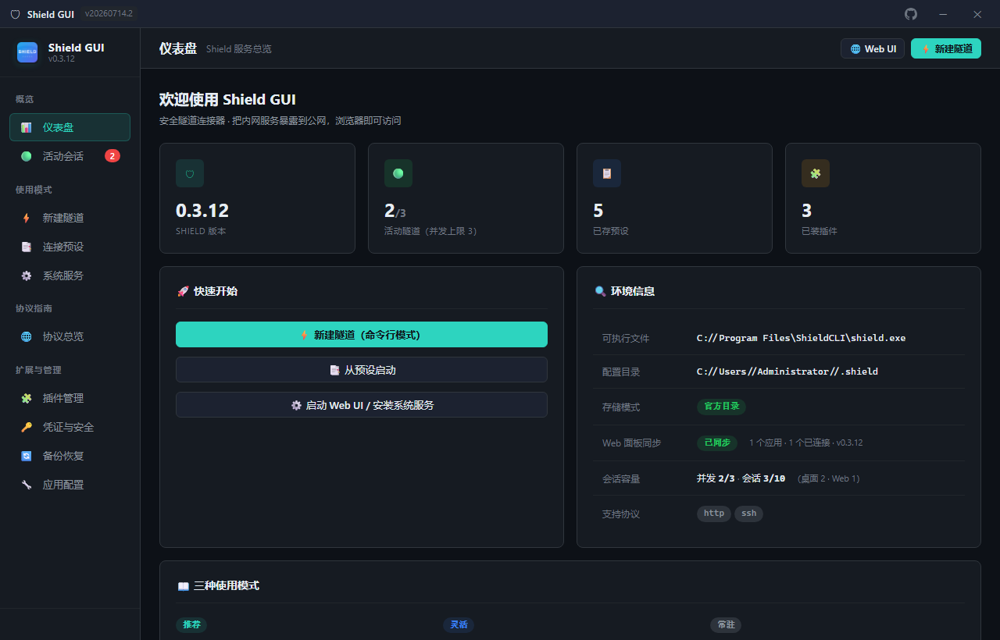
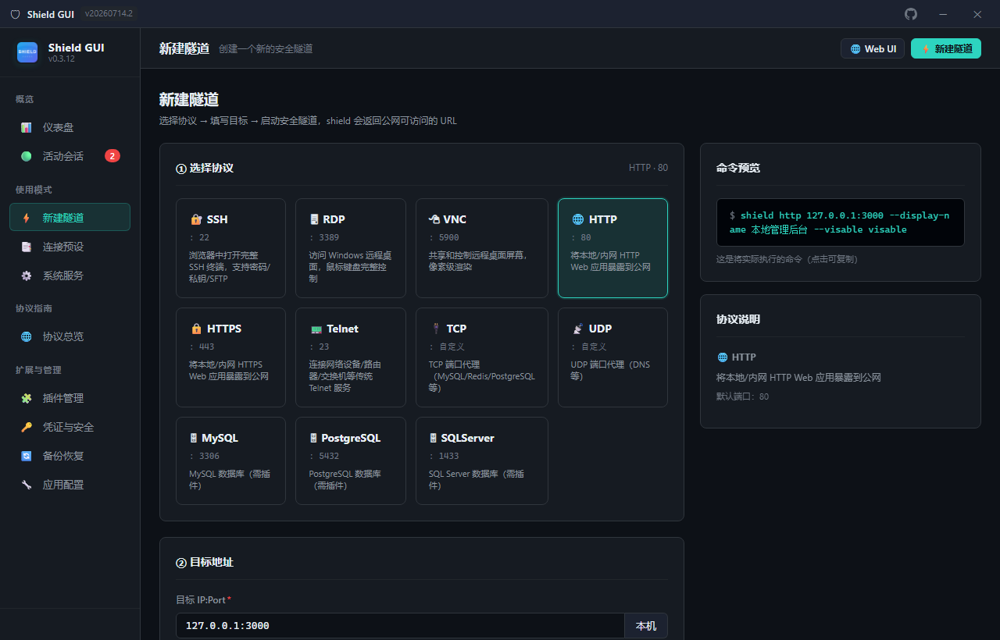
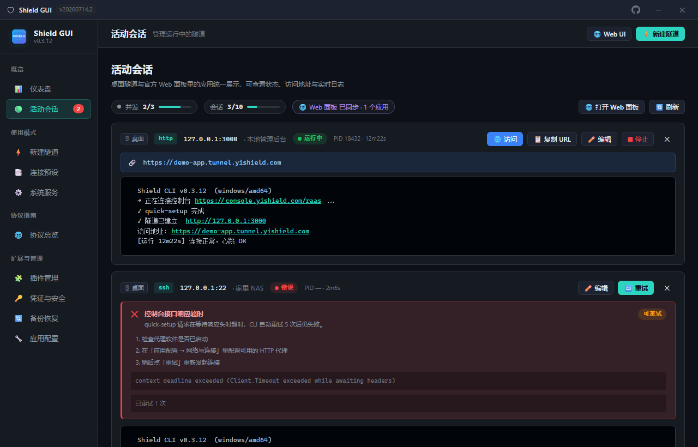
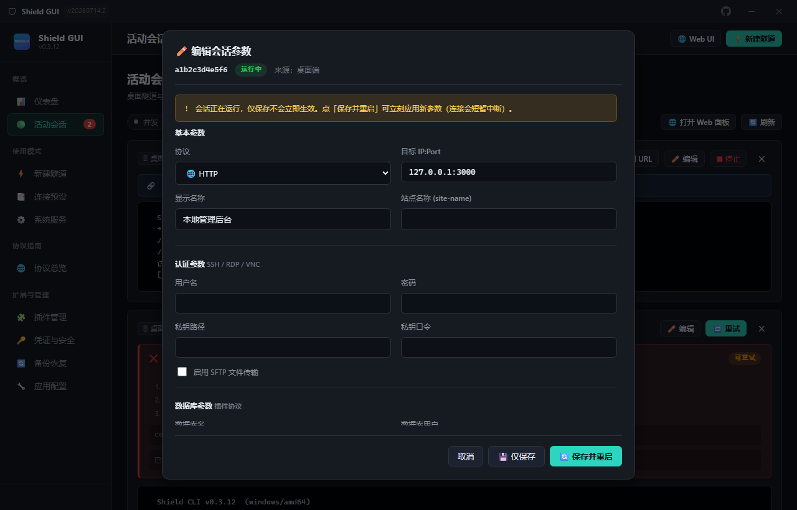

<div align="center">
  

  <h1>Shield GUI</h1>

  <p><b>Shield CLI 的 Windows 桌面客户端</b><br>
  不用敲命令行，也能把内网服务安全地暴露到公网</p>

  <p>
    
    
    
    
    
  </p>
</div>

[Shield CLI](https://www.yishield.com/) 是一款把本地/内网服务映射成公网 HTTPS 地址的命令行工具。Shield GUI 用 **pywebview + 原生 HTML/CSS/JS** 给它套了一层 Windows 桌面外壳：所有配置、启动、日志和排错都在一个窗口里完成，命令仍然由 `shield.exe` 真正执行，不改写、不劫持 CLI 行为。

**为什么用它**

- 🛡 **不敲命令**：选协议、填目标、点启动，右侧实时预览将要执行的 `shield` 命令。
- 🔗 **一个列表管全部**：桌面端启动的隧道和官方 Web 面板（`localhost:8181`）里添加的应用合并展示，共用 3 并发 / 10 会话额度。
- ✏️ **会话可编辑**：点卡片上的「编辑」直接改协议、目标、认证与高级参数，可「仅保存」或「保存并重启」，无需删掉重建。
- 🩺 **报错看得懂**：quick-setup 超时、代理失效等 CLI 英文报错会翻译成中文诊断，附处理建议与一键重试。
- ⬆️ **更新不跳浏览器**：Release 直链 + 国内镜像并行测速下载，GUI 自替换重启，CLI 更新先结束占用进程再替换并自动恢复会话。
- 🧩 **完整桌面体验**：无边框窗口、自定义标题栏、边缘缩放、系统托盘后台常驻、备份恢复与插件管理。

---

## 🖼 界面预览

> 以下为真实界面渲染（演示数据）。UI 改版后可执行 `python docs/generate_screenshots.py` 重新生成配图。

### 仪表盘



打开即总览：Shield CLI 版本、活动隧道数（带 3 个并发上限）、已存预设与插件数一眼可见；「环境信息」列出可执行文件路径、配置目录、存储模式与 Web 面板同步状态。首次使用、未检测到 `shield.exe` 时，这一页会自动切换成安装向导，提供直链/镜像下载安装、`winget` / `scoop` / `choco` 与官网下载等多种方式。

### 新建隧道



支持 SSH、RDP、VNC、HTTP(S)、Telnet、TCP、UDP 以及三种数据库插件协议。每张协议卡片标注默认端口与用途；填完目标地址后，右侧「命令预览」实时生成实际执行的 `shield` 命令，可点击复制。认证、数据库、站点名称、AC 节点、隧道端口、自定义服务器、隐身模式等高级参数都能展开配置，并可一键「存为预设」。

### 活动会话



桌面隧道与 Web 面板应用合并成一个列表，顶部显示「并发 x/3、会话 y/10、Web 面板同步状态」。每张卡片含来源标记、状态徽章、PID/运行时长、访问 URL、实时日志与操作按钮。连接失败时不再假装「运行中」：状态立即纠正为「错误」，并给出中文诊断卡片（原因、建议、原始报错、重试次数）和「🔁 重试」按钮。

### 编辑会话



点「✏️ 编辑」弹出参数面板，自动回填该会话当前的协议、目标、显示名、认证与高级选项，未知自定义参数也会原样保留。表单改动实时刷新命令预览；「仅保存」在下次启动时生效，运行中的会话可用「保存并重启」立刻应用新参数（会短暂中断连接）。Web 面板来源的会话会引导到官方面板编辑，避免两边配置打架。

---

## 功能特性

| 功能 | 说明 |
|---|---|
| **新建隧道** | 选择 8 种协议（SSH/RDP/VNC/HTTP/HTTPS/Telnet/TCP/UDP）+ 3 种数据库插件协议，填写目标地址即生成 CLI 命令 |
| **连接预设** | 保存常用隧道配置，一键启动；兼容 Shield 官方 apps.json 格式；内置 21 种常用端口预设 |
| **活动会话** | 实时日志轮询，自动提取 Access URL，一键停止/移除/重试；**卡片内直接编辑参数**（实时命令预览、保存并重启）；**最多 10 个会话、同时连接 3 个** |
| **Web UI 模式** | 调用 `shield start` 启动官方 Web 管理面板；**面板里添加的应用会同步到「活动会话」**，与桌面端共用 3 并发 / 10 会话额度 |
| **网络诊断** | 启动前分阶段预检 DNS → TCP → TLS → HTTP；CLI 失败的英文报错转成中文诊断 + 处理建议，可配代理、自动重试（0–3 次） |
| **应用内更新** | 不跳转 GitHub：下载 Release 直链或镜像（ghproxy.net / v4.gh-proxy.org），并行测速取最快通道；GUI 自替换并重启，CLI 先结束全部 shield.exe 进程再替换 shield.exe（保留 .bak，失败回滚），完成后自动恢复 Web 面板与会话 |
| **系统服务** | 安装/卸载/启停 Windows 服务 ShieldCLI（需管理员权限） |
| **插件管理** | 安装/移除/升级 MySQL、PostgreSQL、SQL Server 数据库插件 |
| **协议指南** | 8 种协议的详细用法、命令示例与要点备忘 |
| **凭证安全** | AES-256-GCM 加密、隐身模式、缓存清理 |
| **系统托盘** | 关闭窗口隐藏到托盘后台常驻，托盘菜单可快速新建隧道/打开 Web UI/检查更新 |
| **Frameless 窗口** | 自定义标题栏 + 按住拖动 + 边缘/角部 Resize + 最小化/关闭到托盘；**已移除最大化**，双击标题栏改为最小化 |

## 技术栈

| 层 | 技术 |
|---|---|
| 前端 | 原生 HTML/CSS/JS（无框架、无 Tailwind，语义化类名 + 独立样式表） |
| 后端 | Python 3.13+ |
| 桌面容器 | pywebview 6.x（WinForms 原生窗口） |
| 系统托盘 | pystray 0.19+ |
| 进程管理 | subprocess（shield.exe 子进程生命周期） |
| 配置存储 | JSON 文件（兼容 Shield 官方 apps.json 格式） |

## 项目结构

```
shield-gui/
├── main.py                       # 入口：pywebview 窗口创建 + TrayManager（系统托盘）
├── logo.svg                      # 项目 Logo（README 顶部）
├── docs/
│   ├── screenshots/              # README 界面预览图
│   ├── screenshot-inject.html    # 截图用的模拟数据 / 动画禁用桩
│   └── generate_screenshots.py   # 重新生成界面截图
├── core/
│   ├── api.py                    # PythonApi — JS 桥接对象（全部后端方法）
│   ├── shield_runner.py          # ShieldRunner — 子进程管理与日志采集
│   ├── webui_client.py           # WebUIClient — 官方 Web 面板 API（会话同步）
│   ├── updater.py                # 更新通道 — Release 直链 / 镜像下载 / 自我替换
│   ├── process_guard.py          # 更新前枚举并结束全部 shield.exe 进程 / 停服务 / 等文件解锁
│   ├── net_diag.py               # 网络预检（DNS/TCP/TLS/HTTP）+ CLI 错误中文诊断 / 代理环境
│   ├── backup.py                 # 本地 / 远程 / 定时备份
│   └── config_store.py           # ConfigStore — 配置目录探测 + 预设 CRUD
├── ui/
│   ├── index.html                # 主页面：标题栏 / 导航 / 顶栏 / 布局骨架
│   ├── app.js                    # 前端核心：路由 / 状态 / 标题栏控制 / 更新进度 / 视图自愈
│   ├── assets/app.ico            # 窗口与托盘图标
│   ├── styles/
│   │   ├── base.css              # CSS 变量、排版、颜色系统
│   │   ├── layout.css            # 网格 / 导航 / 顶栏 / Resize 手柄
│   │   └── components.css        # 卡片 / 表格 / 按钮 / 表单 / 弹窗 / 诊断卡片
│   └── views/
│       ├── dashboard.js          # 仪表盘：统计、快速开始、安装向导
│       ├── tunnel-new.js         # 新建隧道：协议选择 + 表单 + 命令预览 + 内置预设
│       ├── presets.js            # 连接预设：列表/启动/删除
│       ├── sessions.js           # 活动会话：容量计量 + 日志 + 中文诊断 + **编辑弹窗**
│       ├── protocols.js          # 协议指南：8 种协议的用法与示例
│       ├── plugins.js            # 插件管理：安装/移除/升级
│       ├── service.js            # 系统服务：Web UI 启动 / 服务安装卸载
│       ├── credentials.js        # 凭证与安全：加密机制与清理
│       ├── settings.js           # 应用配置：服务器 / 网络与连接 / 更新通道 / 会话容量
│       └── backup.js             # 备份恢复
└── pyproject.toml                # 项目元数据与依赖声明
```

## 快速开始

### 前置条件

1. 安装 [Shield CLI](https://www.yishield.com/download)
   - 或通过包管理器：`winget install yishield.shieldcli`
2. 确认 `shield.exe` 在系统 PATH 中
3. 安装 Python 3.13+ 和 pywebview

### 启动 GUI

```bash
cd shield-gui

# 推荐：uv（自动创建虚拟环境并同步依赖）
uv sync
uv run python main.py

# 或 pip
pip install pywebview
python main.py
```

### 使用工作流

```
未安装 SHIELD                    已安装 SHIELD
    │                                  │
    ├─ 仪表盘显示安装向导              ├─ 仪表盘：统计 + 快速开始
    │   ├─ 一键下载（直链 / 镜像）     │   ├─ 新建隧道（命令行模式）
    │   ├─ winget / scoop / choco     │   ├─ 从预设启动
    │   └─ 重新检测按钮                │   └─ Web UI / 系统服务
    │                                  │
    └─ 安装完成后重启 GUI              └─ 新建隧道 → 选择协议 → 填写目标 → 启动
                                              │
                                              ├─ 保存为预设（下次一键启动）
                                              └─ 活动会话里查看 / 编辑 / 重启 / 排错
```

## 路由表

| 路由 | 视图 | 说明 |
|---|---|---|
| `dashboard` | 仪表盘 | 服务总览、状态统计、快速开始 / 安装向导 |
| `tunnel-new` | 新建隧道 | 协议选择 + 参数表单 + 实时命令预览 |
| `presets` | 连接预设 | 已保存配置的管理 |
| `sessions` | 活动会话 | 统一列表、容量计量、实时日志、中文诊断、会话编辑 |
| `protocols` | 协议指南 | 8 种协议的详细用法文档 |
| `plugins` | 插件管理 | 数据库插件的安装与管理 |
| `service` | 系统服务 | Web UI 启动、服务安装/卸载/启停 |
| `credentials` | 凭证与安全 | 加密机制说明、凭证缓存清理 |
| `backup` | 备份恢复 | 本地 / 远程 / 定时备份 |
| `settings` | 应用配置 | 自定义服务器、网络与连接、更新通道、会话容量 |

## API 桥接（pywebview js_api）

前端通过 `window.pywebview.api.<method>()` 调用以下后端方法：

| 方法 | 用途 |
|---|---|
| `get_env()` | 环境检测（版本、路径、协议） |
| `build_argv(params)` | 表单参数 → shield argv（命令预览） |
| `start_tunnel(params, force=False)` | 启动隧道（合并默认设置 → 网络预检 → spawn；预检失败返回 `need_confirm`，`force=True` 跳过预检） |
| `probe_server(server, proxy)` | 分阶段测试控制台连通性，返回各阶段耗时与中文建议 |
| `get_session(sid)` | 会话详情，含 `argv`、可回填的 `params` 与 `editable` 标记 |
| `update_session(sid, params, restart=False)` | **编辑会话**：反解/重建 argv 并原地更新；`restart=True` 用新参数重启（受容量上限约束），运行中仅保存时返回 `need_restart` |
| `retry_session(sid)` / `restart_session(sid)` | 复用原参数重试/重启，保留上次日志与重试计数 |
| `stop_tunnel(sid)` / `remove_session(sid)` | 停止/移除会话（`web:<id>` 走 Web 面板 API） |
| `list_sessions()` / `poll_log(sid, offset)` | 会话查询与日志轮询（本地 + Web 面板合并） |
| `session_limits()` | 容量占用：并发 x/3、会话 y/10、Web 面板在线状态 |
| `web_ui_info()` | Web 面板在线状态、版本、应用数、已连接数 |
| `check_updates()` | 检测 GUI/CLI 新版本，返回直链 + 镜像候选链接 |
| `install_update(target)` | 应用内下载并替换（`gui` 自替换重启 / `shield` 替换 shield.exe） |
| `get_update_config()` / `save_update_mirrors(list)` | 更新通道与镜像前缀读写 |
| `start_web_ui(port)` / `open_web_ui(port)` | 启动 / 打开 Web 面板 |
| `service_install/stop/uninstall()` | 系统服务管理 |
| `plugin_list/add/remove/upgrade()` | 插件管理 |
| `list_presets/save_preset/del_preset()` | 预设管理 |
| `clean_credentials()` | 凭证缓存清理 |
| `load_settings/save_settings()` | 用户设置读写 |
| `pick_private_key()` | 文件对话框选择私钥 |
| `window_minimize()` / `window_close()` | 最小化 / 关闭（隐藏到托盘）；标题栏双击映射到 `window_minimize` |
| `window_show/hide()` | 窗口显隐控制 |
| `window_move_by(dx, dy)` | 标题栏拖拽移动 |
| `window_get_bounds()` / `window_set_bounds()` | 窗口位置/尺寸读写（边缘 Resize） |

> 已移除 `window_maximize` / `window_restore`：无边框窗口不再提供最大化能力。

## 常见问题

**Q：启动会话报错 `HTTP request failed: Post "https://console.yishield.com/raas/api/public/quick-setup": context deadline exceeded (Client.Timeout exceeded while awaiting headers)`？**
A：这不是隧道参数错，而是 **CLI 启动时要先向控制台注册（quick-setup），等待响应头超时了**。常见原因是到 `console.yishield.com` 的链路丢包、服务端繁忙，或系统代理已失效导致请求一直挂起（Go 的 `net/http` 会读 `HTTP_PROXY/HTTPS_PROXY`，代理软件没开但注册表/环境变量还留着地址时最容易中招）。GUI 现在的处理方式：

1. **启动前预检**：分阶段探测 DNS → TCP → TLS → HTTP（约 2.5 秒，成功结果缓存 5 分钟），不通时弹出中文诊断，可选择「仍要启动」，不会硬拦。
2. **失败不再假装运行中**：CLI 打印 `✗ Connection failed` 或异常退出时，会话状态立即纠正为「错误」，并附上中文原因与处理建议、推送通知；原始日志仍完整保留。
3. **重试**：可恢复错误（超时 / 5xx）默认自动重试 1 次，也能在会话卡片点「🔁 重试」；重试会复用原参数并保留上次日志。自动重试次数在「应用配置 → 网络与连接」可调（0–3）。
4. **换通道**：在同一处可填 HTTP 代理（传给 CLI 子进程），或改自定义服务器地址；点「🔌 测试连接」可看到各阶段耗时。设置页保存的 `--server` 现在会真正作用于所有新建隧道。

若只是偶发抖动，稍后重试即可；若持续超时，优先检查代理软件状态与 DNS，并在「应用配置」里做一次连接测试定位卡在哪一阶段。

**Q：更新时提示「所有下载通道均失败」？**
A：在「应用配置 → 更新通道」里确认镜像前缀可用（默认 `https://ghproxy.net/`、`https://v4.gh-proxy.org/`），可增删或换成自建镜像；应用会并行测速，优先走最快的通道，直链作为兜底。

**Q：更新 GUI 后程序自动关闭了？**
A：这是正常的自替换流程：新版本下载到临时目录后，由守护脚本在本进程退出后覆盖 exe 并重新启动。源码运行（`python main.py`）时无法替换自身，只会把新版本下载到临时目录并提示路径。

**Q：仪表盘显示「TypeError: Views.dashboard is not a function」？**
A：说明 `ui/views/dashboard.js` 没被加载成功，通常是 WebView2 缓存了空/损坏的脚本副本，或者运行的是旧版打包 exe（内嵌资源不会随源码更新）。现在的 `index.html` 给所有脚本和样式表加了版本号参数绕开缓存；`app.js` 启动时会检查全部视图函数，缺失的脚本自动带随机参数重载一次（提示「已自动恢复 N 个页面脚本」），进入页面时若仍缺失也会再自愈。若继续报错，请用源码运行 `python main.py` 验证，或重新构建 exe。

**Q：更新 Shield CLI 会不会把正在跑的隧道弄断？**
A：会短暂中断，这是必要步骤。运行中的 `shield.exe` 会锁住目标文件，因此更新时先结束**所有** shield.exe 进程（桌面隧道、Web 面板、系统托盘、命令行实例、Windows 服务），确认文件解除占用后才替换。替换完成后 GUI 会按原端口重启 Web 面板、重连面板应用并恢复之前的隧道会话（受 3 个并发上限约束，超出部分需手动启动）；新版本无法运行或版本未提升时自动用 `shield.exe.bak` 回滚，失败时同样会恢复原有会话。

**Q：Web 面板里添加的应用为什么没出现在「活动会话」？**
A：需要面板在线（`shield start` 或系统服务运行中）。GUI 每 2 秒拉取一次 `/api/apps`；离线时列表只显示桌面端会话。面板端口可在「应用配置 → 会话容量」调整。

**Q：为什么最多只能同时连 3 个、最多 10 个会话？**
A：这是内置容量约束（Web 面板应用与桌面隧道共用额度）。达到上限时启动会被拒绝，需先停止或移除不用的会话。

**Q：编辑会话参数后什么时候生效？**
A：点「仅保存」只更新该会话的参数记录，**运行中的连接不会变**，下次点「▶ 启动」或「🔄 保存并重启」才使用新配置。「保存并重启」会停掉旧进程、用新参数起一个新会话并替换列表里的旧条目（同样受 3 并发 / 10 会话上限约束）。编辑只作用于当前会话，不会改动已保存的连接预设；Web 面板来源的会话请到面板里修改。

**Q：为什么没有最大化按钮？双击标题栏会怎样？**
A：无边框窗口最大化时 Windows DWM 容易残留边框与顶部空隙，因此本应用主动移除了最大化能力：标题栏只保留最小化（─）和关闭（✕）。**按住标题栏可拖动窗口**，**双击标题栏会最小化窗口**（不再出现「双击没反应」）。窗口大小通过四边/四角的 Resize 手柄调整；关闭按钮默认隐藏到系统托盘，可从托盘恢复。

**Q：点击"新建隧道"后协议选择区是空的？**
A：这是 0.1.0 版本的已知问题，已在后续版本修复。刷新页面或重启 GUI 即可。

**Q：关闭窗口后程序去哪了？**
A：点击关闭按钮会将窗口隐藏到系统托盘，程序仍在后台运行。可从托盘菜单「退出」彻底关闭，或双击托盘图标恢复窗口。

**Q：Web UI 启动后无法访问？**
A：确认端口未被占用。在「系统服务」页修改端口后重新启动。也可手动运行 `shield start <port>` 排查输出日志。

**Q：shield.exe 已安装但 GUI 检测不到？**
A：确认 shield.exe 在 PATH 环境变量中。重启 Shield GUI 后会自动重新检测。如仍未识别，可在终端执行 `shield --version` 确认安装正常。

**Q：frameless 窗口如何调整大小？**
A：将鼠标移动到窗口边缘（上下左右）或四角，光标变为双向箭头后拖拽即可调整窗口大小。窗口不再提供最大化按钮；想快速收起可点标题栏右侧的 ─，或双击标题栏。

## 许可证

MIT License
